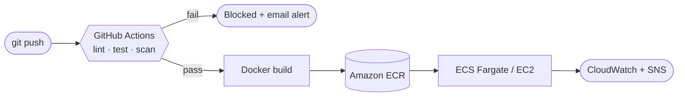

 

 

> I take code from commit to a **reachable, observable production URL**. I ship Dockerized apps through GitHub Actions to AWS, watch them with health checks, logs and alerts, and learn by breaking real systems and fixing them.

 

## At a Glance

| | |
| :--- | :--- |
| **Currently** | DevOps Engineer Intern @ **Springer Capital** · Remote (Wilmette, Illinois, USA) |
| **Core** | Linux · Git & GitHub · Docker · CI/CD · AWS · Kubernetes |
| **Building** | **Kleos** (LLM DevOps assistant) · **DevSecOps Agent** |
| **Based in** | Dhaka, Bangladesh |
| **Open to** | DevOps · Cloud · SRE · Platform Engineering |

 

## Story So Far

| When | What |
| :--- | :--- |
| **Aug 2026 – Present** | DevOps Engineer Intern @ **Springer Capital**: n8n automation, local LLM serving, Grafana Loki audits |
| **Aug 2026 – Present** | DevOps and Cloud Engineering bootcamp @ **bongoDev** |
| **Nov 2025 – Feb 2026** | Junior Executive @ **SkyTech Solutions** |
| **Dec 2021 – Dec 2025** | B.Sc. in Computer Engineering @ **BUBT** |

 

## The Pipeline I Ship With

 

## Featured Work

<table>
<tr>
<td width="50%" valign="top">

### 🚨 [Incident Manager](https://github.com/tanahmeeedsx/incident-management)
MERN incident and on-call tracker on **AWS EC2**. Deployed to Ubuntu 24.04 with Security Groups, SSH key auth and MongoDB under systemd.

`AWS EC2` `Ubuntu` `systemd` `MongoDB` `Bash`

</td>
<td width="50%" valign="top">

### ☁️ [CloudMentor](https://github.com/tanahmeeedsx/cloud-mentor)
Serverless AI classroom. React on EC2 + Nginx, API Gateway + Lambda, S3 and DynamoDB, deployed with AWS SAM through GitHub Actions.

`AWS Lambda` `API Gateway` `DynamoDB` `S3` `CloudFormation` `GitHub Actions`

</td>
</tr>
<tr>
<td width="50%" valign="top">

### 🐳 [Expense Tracker](https://github.com/tanahmeeedsx/expense-tracker)
Dockerized expense app on **AWS EC2**. Multi-stage builds, Docker Compose with custom networks, and MongoDB backups to S3 via cron, restore-tested.

`Docker` `Docker Compose` `AWS EC2` `S3` `IAM`

</td>
<td width="50%" valign="top">

### 📈 [FlashScale](https://github.com/tanahmeeedsx/aiops-flashscale-app)
AIOps load-testing platform. A load test reaching **170K users**, with CloudWatch dashboards, alarms and SNS alerts. EC2 provisioned with Terraform.

`k6` `Terraform` `CloudWatch` `SNS` `NGINX` `Redis`

</td>
</tr>
<tr>
<td width="50%" valign="top">

### 🛡️ [DevSecOps Agent](https://github.com/tanahmeeedsx/devsecops-agent)
Container and cloud security platform. Trivy image scans, container health, and AWS inspection across ECS, ECR, Security Groups, S3 and IAM.

`Trivy` `Docker` `AWS SSM` `ECS` `ECR` `IAM`

</td>
<td width="50%" valign="top">

### 🤖 [Kleos · LLM DevOps Assistant](https://github.com/tanahmeeedsx/LLM-chatbot-assistant)
MCP-powered chatbot for CI/CD troubleshooting. Investigates GitHub Actions failures and analyzes job logs using a local Qwen 2.5 model via Ollama.

`Python` `Streamlit` `MCP` `Ollama` `GitHub CLI`

</td>
</tr>
</table>

 

## Incident Log

*Real breakages from my projects, and what they taught me.*

| 🔥 Problem | 🛠️ Fix | 💡 Lesson |
| :--- | :--- | :--- |
| **Deploy failed** on a missing `SAM_STACK_NAME` secret in GitHub Actions | Read the Actions logs, added the missing repository secret, re-ran the deploy | Read the logs before changing code |
| **Backend image** flagged with **21** Docker Scout findings | Removed the bundled npm CLI from the runtime image, rebuilt and rescanned: now **0** in Docker Scout and Trivy | Build tools belong in the builder stage, not production |
| **Backups** with no restore test yet | Restored the latest MongoDB backup into a separate test database and verified every record | A backup is only real after a restore |

 

## What I Work On

| | |
| :--- | :--- |
| ☁️ **AWS** | EC2 · ECS Fargate · ECR · Lambda · API Gateway · S3 · DynamoDB · CloudFormation · IAM |
| 🐳 **Containers** | Docker · Docker Compose · multi-stage builds · Docker Scout |
| ⎈ **Kubernetes** | Minikube · Kind · kubeadm · Pods · Deployments · Services · Ingress · YAML manifests |
| 🛡️ **DevSecOps** | Trivy · CodeQL · npm audit · secret scanning · least-privilege IAM |
| 📈 **AIOps & Observability** | k6 load testing · CloudWatch alarms · SNS · Grafana · Loki · Prometheus |
| 🤖 **AI Agents** | MCP · Ollama · Qwen 2.5 · Llama 3.2 · FastAPI · Streamlit |
| 🔄 **CI/CD & Automation** | GitHub Actions · n8n · Terraform · Bash · systemd |

 

## Tech Arsenal

  

 

## Open Source & Streak

  

  

 

## Let's Build Something Reliable

Looking for **DevOps, Cloud, SRE and Platform Engineering** roles where I can ship, operate and improve production systems, and automate the parts that keep them up at 3 a.m.

  

🛠️ <b>Build it. Ship it. Watch it. Improve it.</b>

